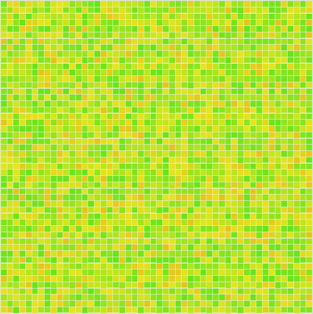

# Fire simulation



A small fire simulation built with React and TypeScript. The fire spreads between
nearby cells depending on soil dryness and wind direction and strength.
Red cells are burning; black cells have burned.

Select one or more wind directions, or **None**. Use the sliders to adjust wind
strength and soil dryness. Click the grid to start a fire, then use **Play / Pause**
or **Next step**. **Reset** creates a new grid and keeps your settings.

## Run locally

With Node.js 24+ and npm installed:

```bash
git clone https://github.com/ksamayo/fire-simulation.git
cd fire-simulation
npm install
npm run dev
```

Open [localhost:5173](http://localhost:5173) in your browser.
